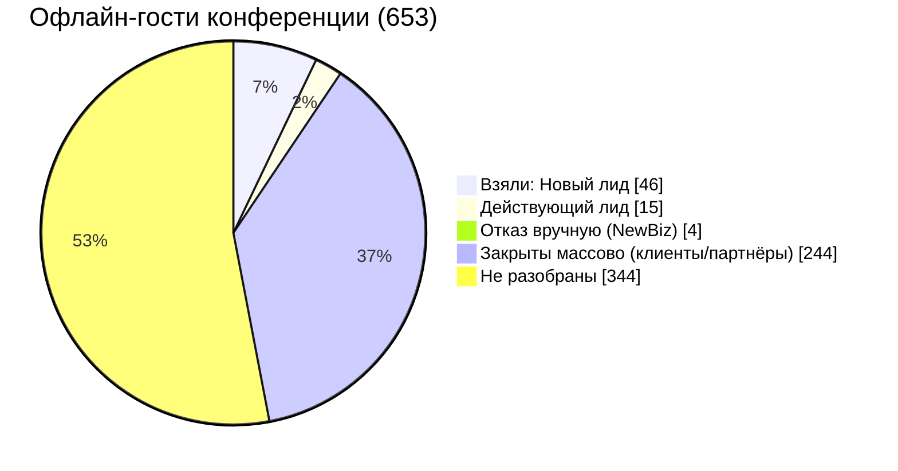
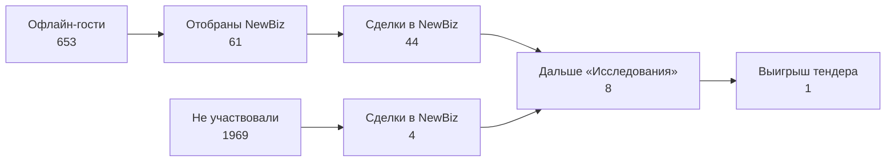

# Отработка гостей «Конференции 2026» командой NewBiz

Дата конференции: **16.07.2026**. Срез данных из amoCRM: **17.11.2026**. Воронки: «Конференция 2026» (id 10631686) и «NewBiz» (id 9673226).

## Коротко

- В воронке конференции **3792** сделок, из них офлайн-гостей (без сотрудников RoRe) — **653**. Именно они — рабочий список NewBiz по инструкции (этап «Факт присутствия»).
- Разобрано **309** из 653 офлайн-гостей (47.3%). Вручную командой NewBiz — **65** (46 взяты как «Новый лид», 15 — «Действующий лид», 4 — отказ по другим причинам). Ещё **244** закрыты массово с учётной записи «Родная Речь» (клиенты, партнёры, PR-партнёры и т.п.).
- **Не разобрано: 344** офлайн-гостей (52.7%) — все они так и стоят на этапе «Факт присутствия» без причины отказа и без отметки «Новый лид».
- В воронку NewBiz из гостей конференции перешло **48** сделок (+3 сделки «Национальных приоритетов» — действующего клиента DARR, их считаем отдельно). От офлайн-гостей — **44** сделок, это **6.7%** офлайн-аудитории.
- Из 48 сделок **36** ещё на этапе «Исследование», **8** продвинулись дальше, **1** — «Выигрыш тендера», **4** — отказ/проигрыш. Онлайн-участники в NewBiz не перешли ни разу.

## 1. Кто был в воронке «Конференция 2026»

| Сегмент | Сделок | Доля |
|---|---:|---:|
| Офлайн-участники | 653 | 17.2% |
| Онлайн-участники | 774 | 20.4% |
| Не участвовали | 1969 | 51.9% |
| Сотрудники RoRe | 396 | 10.4% |
| **Всего** | **3792** | 100% |

Сегмент определён по полям сделки: «Сотрудник» → сотрудники; «Участвовал офлайн» → офлайн; «Участвовал онлайн» → онлайн; иначе — не участвовал. Этапы: Участие — 1442, Факт присутствия — 353, Не участие — 1997.

## 2. Как отработали офлайн-гостей

| Результат | Сделок | Доля от офлайн-гостей | Кто проставил |
|---|---:|---:|---|
| Взяли в работу («Новый лид») | 46 | 7.0% | NewBiz |
| Причина отказа: Действующий лид | 15 | 2.3% | NewBiz |
| Причина отказа: Не профильная компания | 2 | 0.3% | NewBiz |
| Причина отказа: Нет бюджета | 1 | 0.2% | NewBiz |
| Причина отказа: Не актуально сейчас | 1 | 0.2% | NewBiz |
| Причина отказа: Действующий клиент | 111 | 17.0% | массово («Родная Речь») |
| Причина отказа: Действующий партнер | 85 | 13.0% | массово («Родная Речь») |
| Причина отказа: PR-партнер | 36 | 5.5% | массово («Родная Речь») |
| Причина отказа: Некорректные контактные данные | 8 | 1.2% | массово («Родная Речь») |
| Причина отказа: Конкурент | 2 | 0.3% | массово («Родная Речь») |
| Причина отказа: Не целевой контакт | 2 | 0.3% | массово («Родная Речь») |
| **Не разобраны** | **344** | **52.7%** | — |
| Итого | 653 | 100% | |

### Кто из NewBiz что сделал

| Сотрудник | Новый лид | Действующий лид | Другие отказы |
|---|---:|---:|---:|
| Наталья Белова | 36 | 15 | 4 |
| Тимур Миненков | 10 | 0 | 0 |

> «Родная Речь» — общая админская учётка: с неё массово проставлены «Сотрудник», «Действующий клиент», «Действующий партнёр», «PR-партнёр» и т.д. Это не ручная отработка NewBiz, поэтому показано отдельно.

Сотрудники RoRe (396) и онлайн-участники в рабочий список не входили; у онлайн-участников причины отказа проставлены только массово (13 шт.).

## 3. Что перешло в NewBiz

Сделка NewBiz считается пришедшей с конференции, если она **создана после 16.07.2026** и у неё **тот же контакт**, что у гостя в воронке конференции (для 3 гостей с отметкой «Новый лид» связь найдена по компании — сделку на компанию уже завёл коллега).

| Откуда | Гостей | Сделок в NewBiz | Конверсия гость → сделка |
|---|---:|---:|---:|
| Офлайн · «Новый лид» | 46 из 46 | 39 | 100.0% |
| Офлайн · «Действующий лид» | 8 из 15 | 7 | 53.3% |
| Не участвовали (регистрация без визита) | 5 из 1969 | 4 | 0.3% |
| Онлайн-участники | 0 из 774 | 0 | 0% |
| **Итого (без Нацприоритетов)** | | **48** | |

Конверсия от всего офлайн-потока: **44 сделок / 653 гостей = 6.7%**; от отобранных NewBiz лидов («Новый лид» + «Действующий лид» = 61): **72.1%** (несколько гостей из одной компании → одна сделка).

### На каком этапе сейчас

| Этап NewBiz | Сделок | Доля |
|---|---:|---:|
| Исследование | 36 | 75.0% |
| Первый контакт | 2 | 4.2% |
| Встреча назначена | 1 | 2.1% |
| Прогрев | 2 | 4.2% |
| Участие в тендере | 2 | 4.2% |
| Выигрыш тендера | 1 | 2.1% |
| Отказ | 2 | 4.2% |
| Проигрыш | 2 | 4.2% |
| **Всего** | **48** | 100% |

В активной работе (не отказ/проигрыш): **44**. Сумма бюджетов в сделках: **5 898 000 ₽** (у большинства сделок бюджет не заполнен).

### Список сделок

| Сделка NewBiz | Этап | Ответственный | Создана | Источник | Гость(и) в «Конференции 2026» |
|---|---|---|---|---|---|
| [360 executive hotel management // Скоуп?//Исследование](https://roregroup.amocrm.ru/leads/detail/71473933) | Исследование | Наталья Белова | 2026-09-24 | Офлайн · «Новый лид» | [70809047](https://roregroup.amocrm.ru/leads/detail/70809047) |
| [A3 // Скоуп?// Исследование](https://roregroup.amocrm.ru/leads/detail/71191010) | Исследование | Наталья Белова | 2026-08-13 | Офлайн · «Новый лид» | [70384491](https://roregroup.amocrm.ru/leads/detail/70384491) |
| [Fratelli Guzzini// Скоуп?// Исследование](https://roregroup.amocrm.ru/leads/detail/71475627) | Исследование | Наталья Белова | 2026-09-24 | Офлайн · «Новый лид» | [70948413](https://roregroup.amocrm.ru/leads/detail/70948413) |
| [GLS Pharmaceuticals //Скоуп?//Исследование](https://roregroup.amocrm.ru/leads/detail/71473617) | Исследование | Наталья Белова | 2026-09-24 | Офлайн · «Новый лид» | [70917541](https://roregroup.amocrm.ru/leads/detail/70917541) |
| [Groupe SEB // Скоуп? // Исследование](https://roregroup.amocrm.ru/leads/detail/71435113) | Исследование | Наталья Белова | 2026-09-18 | Офлайн · «Новый лид» | [70773707](https://roregroup.amocrm.ru/leads/detail/70773707) |
| [Lady&Gentleman City //Скоуп // Исследование](https://roregroup.amocrm.ru/leads/detail/71436017) | Исследование | Наталья Белова | 2026-09-18 | Офлайн · «Действующий лид» | [70962929](https://roregroup.amocrm.ru/leads/detail/70962929) |
| [Laimalux //Скоуп? // Исследование](https://roregroup.amocrm.ru/leads/detail/71473911) | Исследование | Наталья Белова | 2026-09-24 | Офлайн · «Новый лид» | [70280964](https://roregroup.amocrm.ru/leads/detail/70280964) |
| [MD Group // Исследование](https://roregroup.amocrm.ru/leads/detail/71190750) | Исследование | Наталья Белова | 2026-08-13 | Офлайн · «Действующий лид» | [70288939](https://roregroup.amocrm.ru/leads/detail/70288939) |
| [Points Health // Скоуп?//Исследование](https://roregroup.amocrm.ru/leads/detail/71474057) | Исследование | Наталья Белова | 2026-09-24 | Офлайн · «Новый лид» | [70977287](https://roregroup.amocrm.ru/leads/detail/70977287) |
| [Positive Tech // Скоуп?//Исследование](https://roregroup.amocrm.ru/leads/detail/71474141) | Исследование | Наталья Белова | 2026-09-24 | Офлайн · «Новый лид» | [70697491](https://roregroup.amocrm.ru/leads/detail/70697491) |
| [QUALITY OIL // Скоуп?// Исследование](https://roregroup.amocrm.ru/leads/detail/71474199) | Исследование | Наталья Белова | 2026-09-24 | Офлайн · «Новый лид» | [70888247](https://roregroup.amocrm.ru/leads/detail/70888247) |
| [TZOM // Скоуп? // Ислледование](https://roregroup.amocrm.ru/leads/detail/71473695) | Исследование | Наталья Белова | 2026-09-24 | Офлайн · «Новый лид» | [70917303](https://roregroup.amocrm.ru/leads/detail/70917303) |
| [itab // Скоуп?//Исследование](https://roregroup.amocrm.ru/leads/detail/71435141) | Исследование | Наталья Белова | 2026-09-18 | Офлайн · «Новый лид» | [70778587](https://roregroup.amocrm.ru/leads/detail/70778587) |
| [mirds.ru // Скоуп? //Исследование](https://roregroup.amocrm.ru/leads/detail/71435159) | Исследование | Наталья Белова | 2026-09-18 | Офлайн · «Действующий лид»; Офлайн · «Новый лид» | [70857963](https://roregroup.amocrm.ru/leads/detail/70857963), [70857997](https://roregroup.amocrm.ru/leads/detail/70857997), [70858045](https://roregroup.amocrm.ru/leads/detail/70858045) |
| [АмериаРусс//Скоуп(?)//2027](https://roregroup.amocrm.ru/leads/detail/71496207) | Исследование | Елизавета Ильина (DARR) | 2026-09-27 | Офлайн · «Новый лид» | [70983389](https://roregroup.amocrm.ru/leads/detail/70983389) |
| [ГК Лето // Скоуп? // Исследование](https://roregroup.amocrm.ru/leads/detail/71474469) | Исследование | Наталья Белова | 2026-09-24 | Офлайн · «Новый лид» | [70261856](https://roregroup.amocrm.ru/leads/detail/70261856) |
| [Гельтек // Prometheus Serpent перезапуск // 26-27](https://roregroup.amocrm.ru/leads/detail/71191691) | Исследование | Наталья Белова | 2026-08-13 | Офлайн · «Действующий лид» | [70642715](https://roregroup.amocrm.ru/leads/detail/70642715) |
| [ДП//Скоуп(?)//2027](https://roregroup.amocrm.ru/leads/detail/71496131) | Исследование | Наталья Белова | 2026-09-27 | Офлайн · «Новый лид» | [70898775](https://roregroup.amocrm.ru/leads/detail/70898775) |
| [Дунфэн Трак Рус // Скоуп?// Исследование](https://roregroup.amocrm.ru/leads/detail/71474733) | Исследование | Наталья Белова | 2026-09-24 | Офлайн · «Новый лид» | [70886941](https://roregroup.amocrm.ru/leads/detail/70886941) |
| [Дымов // Скоуп? // Исследование](https://roregroup.amocrm.ru/leads/detail/71474491) | Исследование | Наталья Белова | 2026-09-24 | Офлайн · «Новый лид» | [70743983](https://roregroup.amocrm.ru/leads/detail/70743983) |
| [Консумед // Скоуп? // Исследование](https://roregroup.amocrm.ru/leads/detail/71435561) | Исследование | Наталья Белова | 2026-09-18 | Офлайн · «Новый лид» | [70970911](https://roregroup.amocrm.ru/leads/detail/70970911) |
| [Куртц // Скоуп? // Исследование](https://roregroup.amocrm.ru/leads/detail/71474647) | Исследование | Наталья Белова | 2026-09-24 | Офлайн · «Новый лид» | [70964659](https://roregroup.amocrm.ru/leads/detail/70964659) |
| [Логитек (Баркли) // Скоуп ?// Исследование](https://roregroup.amocrm.ru/leads/detail/71474687) | Исследование | Наталья Белова | 2026-09-24 | Офлайн · «Новый лид» | [70969917](https://roregroup.amocrm.ru/leads/detail/70969917) |
| [МБ Рус//Скоуп(?)//2027](https://roregroup.amocrm.ru/leads/detail/71496257) | Исследование | Наталья Белова | 2026-09-27 | Офлайн · «Новый лид» | [70977529](https://roregroup.amocrm.ru/leads/detail/70977529) |
| [ООО«Хэппи» // Скоуп? // Исследование](https://roregroup.amocrm.ru/leads/detail/71474865) | Исследование | Наталья Белова | 2026-09-24 | Офлайн · «Новый лид» | [70942869](https://roregroup.amocrm.ru/leads/detail/70942869) |
| [Останкинский мясоперерабатывающий комбинат // Исследование](https://roregroup.amocrm.ru/leads/detail/71191653) | Исследование | Наталья Белова | 2026-08-13 | Офлайн · «Новый лид» | [70584049](https://roregroup.amocrm.ru/leads/detail/70584049) |
| [ПИК // Скоуп? //Исследование](https://roregroup.amocrm.ru/leads/detail/71473747) | Исследование | Наталья Белова | 2026-09-24 | Офлайн · «Новый лид» | [70416121](https://roregroup.amocrm.ru/leads/detail/70416121), [70684467](https://roregroup.amocrm.ru/leads/detail/70684467) |
| [ПРОФИ ПЕРЕЕЗД//Скоуп(?)//2027](https://roregroup.amocrm.ru/leads/detail/71496261) | Исследование | Наталья Белова | 2026-09-27 | Офлайн · «Новый лид» | [70893505](https://roregroup.amocrm.ru/leads/detail/70893505) |
| [Промсистемы // Исследование](https://roregroup.amocrm.ru/leads/detail/71191398) | Исследование | Наталья Белова | 2026-08-13 | Офлайн · «Новый лид» | [70407547](https://roregroup.amocrm.ru/leads/detail/70407547) |
| [Северсталь // Скоуп?//Исследование](https://roregroup.amocrm.ru/leads/detail/71475397) | Исследование | Наталья Белова | 2026-09-24 | Офлайн · «Новый лид» | [70928869](https://roregroup.amocrm.ru/leads/detail/70928869), [70928875](https://roregroup.amocrm.ru/leads/detail/70928875) |
| [Солнечная долина // Скоуп? // Исследование](https://roregroup.amocrm.ru/leads/detail/71435539) | Исследование | Наталья Белова | 2026-09-18 | Офлайн · «Новый лид» | [70968499](https://roregroup.amocrm.ru/leads/detail/70968499) |
| [Трипстер//Скоуп(?)//2027](https://roregroup.amocrm.ru/leads/detail/71496117) | Исследование | Наталья Белова | 2026-09-27 | Офлайн · «Новый лид» | [70466859](https://roregroup.amocrm.ru/leads/detail/70466859) |
| [Фабрика Свобода //Скоуп?// Исследоание](https://roregroup.amocrm.ru/leads/detail/71474413) | Исследование | Наталья Белова | 2026-09-24 | Офлайн · «Новый лид» | [70775923](https://roregroup.amocrm.ru/leads/detail/70775923) |
| [Хайвей логистик групп // Скоуп?// Исследование](https://roregroup.amocrm.ru/leads/detail/71475689) | Исследование | Наталья Белова | 2026-09-24 | Офлайн · «Новый лид» | [70968629](https://roregroup.amocrm.ru/leads/detail/70968629) |
| [Эвоком // Скоуп? // исследование](https://roregroup.amocrm.ru/leads/detail/71474909) | Исследование | Наталья Белова | 2026-09-24 | Офлайн · «Новый лид» | [70384361](https://roregroup.amocrm.ru/leads/detail/70384361), [70660429](https://roregroup.amocrm.ru/leads/detail/70660429), [70696345](https://roregroup.amocrm.ru/leads/detail/70696345) |
| [Эртелеком// Скоуп?//Исследование](https://roregroup.amocrm.ru/leads/detail/71435073) | Исследование | Наталья Белова | 2026-09-18 | Офлайн · «Новый лид» | [70722499](https://roregroup.amocrm.ru/leads/detail/70722499) |
| [Modi//Спецы(?)//2027](https://roregroup.amocrm.ru/leads/detail/71015189) | Первый контакт | Наталья Белова | 2026-07-21 | Офлайн · «Действующий лид» | [70963059](https://roregroup.amocrm.ru/leads/detail/70963059) |
| [Вкусвилл // BX проактив// 2027 ideas](https://roregroup.amocrm.ru/leads/detail/71435431) | Первый контакт | Наталья Белова | 2026-09-18 | Офлайн · «Новый лид» | [70931879](https://roregroup.amocrm.ru/leads/detail/70931879), [70932731](https://roregroup.amocrm.ru/leads/detail/70932731) |
| [Kerama Marazzi//Скоуп(?)//2026](https://roregroup.amocrm.ru/leads/detail/71219355) | Встреча назначена | Дмитрий Делов (DARR) | 2026-08-18 | Офлайн · «Действующий лид»; Офлайн · «Новый лид» | [70712781](https://roregroup.amocrm.ru/leads/detail/70712781), [70715429](https://roregroup.amocrm.ru/leads/detail/70715429) |
| [Merck//GEO-SEO//2026](https://roregroup.amocrm.ru/leads/detail/71015215) | Прогрев | Наталья Белова | 2026-07-21 | Офлайн · «Действующий лид» | [70221268](https://roregroup.amocrm.ru/leads/detail/70221268), [70308461](https://roregroup.amocrm.ru/leads/detail/70308461) |
| [Комус//Е-ком//2026](https://roregroup.amocrm.ru/leads/detail/71014447) | Прогрев | Наталья Белова | 2026-07-21 | Офлайн · «Новый лид» | [70707973](https://roregroup.amocrm.ru/leads/detail/70707973), [70890895](https://roregroup.amocrm.ru/leads/detail/70890895) |
| [Air Liquide // SEO // 2026-2027](https://roregroup.amocrm.ru/leads/detail/71131569) | Участие в тендере | Наталья Белова | 2026-08-05 | Не участвовали (регистрация без визита) | [70875365](https://roregroup.amocrm.ru/leads/detail/70875365) |
| [INMYROOM // Скоуп?// 2026-2027](https://roregroup.amocrm.ru/leads/detail/71167171) | Участие в тендере | Наталья Белова | 2026-08-10 | Офлайн · «Новый лид» | [70921047](https://roregroup.amocrm.ru/leads/detail/70921047) |
| [Национальные Приоритеты//Туризм и индустрия гостеприимства//Путешествия в межсезонье//2026](https://roregroup.amocrm.ru/leads/detail/71124471) ⚑ | Выигрыш тендера | Елизавета Ильина (DARR) | 2026-08-04 | Не участвовали (регистрация без визита) | [70763939](https://roregroup.amocrm.ru/leads/detail/70763939) |
| [Национальные приоритеты // Молодежь и дети//Научные специальности//2026](https://roregroup.amocrm.ru/leads/detail/71134263) ⚑ | Выигрыш тендера | Елизавета Ильина (DARR) | 2026-08-05 | Не участвовали (регистрация без визита) | [70763939](https://roregroup.amocrm.ru/leads/detail/70763939) |
| [Снежная Королева//SEO-GEO//2026](https://roregroup.amocrm.ru/leads/detail/71265279) | Выигрыш тендера | Наталья Белова | 2026-08-25 | Не участвовали (регистрация без визита) | [70591862](https://roregroup.amocrm.ru/leads/detail/70591862) |
| [DrTheiss//Digital (врачи)//2027](https://roregroup.amocrm.ru/leads/detail/71569473) | Отказ | Наталья Белова | 2026-10-06 | Не участвовали (регистрация без визита) | [70448009](https://roregroup.amocrm.ru/leads/detail/70448009) |
| [Radisson//Маркетинговые коммуникации и PR//2026](https://roregroup.amocrm.ru/leads/detail/71049459) | Отказ | Наталья Белова | 2026-07-24 | Офлайн · «Новый лид» | [70394849](https://roregroup.amocrm.ru/leads/detail/70394849) |
| [Авексима(Криспанорм)//Медиа//26-27](https://roregroup.amocrm.ru/leads/detail/71015089) | Проигрыш | Наталья Белова | 2026-07-21 | Не участвовали (регистрация без визита) | [70770505](https://roregroup.amocrm.ru/leads/detail/70770505), [70939505](https://roregroup.amocrm.ru/leads/detail/70939505) |
| [Альтернатива // Поддержка в e-retail // 2026-2027](https://roregroup.amocrm.ru/leads/detail/71191955) | Проигрыш | Наталья Белова | 2026-08-13 | Офлайн · «Новый лид» | [70667495](https://roregroup.amocrm.ru/leads/detail/70667495) |
| [Национальные приоритеты//Молодежь и дети//Учитель навсегда//1 сен – 18 окт2026](https://roregroup.amocrm.ru/leads/detail/71168103) ⚑ | Проигрыш | Елизавета Ильина (DARR) | 2026-08-10 | Не участвовали (регистрация без визита) | [70763939](https://roregroup.amocrm.ru/leads/detail/70763939) |

⚑ — «Национальные приоритеты»: действующий клиент DARR, сделки в NewBiz были и до конференции; в конверсию не включены.

## 4. Что требует внимания

1. **344 офлайн-гостей не разобраны** — нет ни причины отказа, ни «Новый лид». Это остаток в рабочей ссылке; без разметки по ним не посчитать конверсию.
2. **7 гостей с причиной «Действующий лид» без новой сделки в NewBiz.** У 5 из них сделка в NewBiz была ещё до конференции — это по инструкции. У 2 сделки нет ни до, ни после — стоит проверить: [70863933](https://roregroup.amocrm.ru/leads/detail/70863933), [70782441](https://roregroup.amocrm.ru/leads/detail/70782441).
3. **5 зарегистрировавшихся, но не пришедших гостей** дали сделки в NewBiz, но в воронке конференции они никак не помечены — их не видно в отчёте по «Новый лид». У 3 из 4 компаний сделки в NewBiz были и до конференции. Стоит договориться, отмечать ли таких гостей.
4. Большинство сделок (36) стоят на «Исследовании» с названием «Скоуп?» — через месяц имеет смысл повторить срез, чтобы увидеть реальную конверсию в «Таргет» и дальше.

## Методика

- Данные выгружены из amoCRM API v4 (сделки обеих воронок с контактами и компаниями + события изменения полей «Причина отказа», «Новый лид»). Кто проставил поле — по последнему событию изменения.
- `data/conf_aggregate.csv` — все 3 792 сделки воронки конференции, сгруппированные по признакам; `data/conf_leads_linked.csv` — гости, у которых есть ручная разметка или связанная сделка NewBiz; `data/newbiz_linked_deals.csv` — сделки NewBiz, связанные с гостями (включая связь только по компании, она в конверсию не входит — см. приложение).
- Пересобрать отчёт: `python3 scripts/build_report.py`.

## Приложение. Сделки NewBiz с компаниями-гостями (связь только по компании)

Эти сделки заведены после конференции на компании, сотрудники которых были в воронке конференции, но контакт в сделке другой. Прямой связи с отработкой гостей нет, в конверсию не включены.

| Сделка | Этап | Ответственный | Создана |
|---|---|---|---|
| [Global Functional Drinks//Strategy//2026](https://roregroup.amocrm.ru/leads/detail/71405697) | Прогрев | Павел Купалов | 2026-09-14 |
| [Litres//Медийка//2027](https://roregroup.amocrm.ru/leads/detail/71454535) | Прогрев | Дмитрий Делов (DARR) | 2026-09-21 |
| [Realme//Media//2027](https://roregroup.amocrm.ru/leads/detail/71569485) | Подготовка к тендеру | Наталья Белова | 2026-10-06 |
| [Ашан//Media//2027](https://roregroup.amocrm.ru/leads/detail/71325943) | Участие в тендере | Людмила Колоскова | 2026-09-03 |
| [ВК_Дзен//Спецпроекты//2027](https://roregroup.amocrm.ru/leads/detail/71501075) | Участие в тендере | Светлана Кожевникова (TONIC) | 2026-09-28 |
| [Май//All Media//2027](https://roregroup.amocrm.ru/leads/detail/71709757) | Участие в тендере | Анастасия Тимонина | 2026-10-26 |
| [Молвест/Media/2027](https://roregroup.amocrm.ru/leads/detail/71411155) | Участие в тендере | Анастасия Тимонина | 2026-09-15 |
| [Национальные приоритеты//Молодежь и дети//Добровольчество2026](https://roregroup.amocrm.ru/leads/detail/71402495) | Участие в тендере | Елизавета Ильина (DARR) | 2026-09-14 |
| [Национальные приоритеты//ЭКЭ//Меры для бизнеса](https://roregroup.amocrm.ru/leads/detail/71313831) | Участие в тендере | Елизавета Ильина (DARR) | 2026-09-01 |
| [Синтек//Digital//2027](https://roregroup.amocrm.ru/leads/detail/71709779) | Участие в тендере | Анастасия Тимонина | 2026-10-26 |
| [Global Functional Drinks//Analytics//2026](https://roregroup.amocrm.ru/leads/detail/71405725) | Выигрыш тендера | Павел Купалов | 2026-09-14 |
| [Балтика/Media/2026](https://roregroup.amocrm.ru/leads/detail/71142967) | Выигрыш тендера | Ирина Казеннова (LION) | 2026-08-06 |
| [Национальные приоритеты//Кадры//Рабочие специальности](https://roregroup.amocrm.ru/leads/detail/71357099) | Выигрыш тендера | Елизавета Ильина (DARR) | 2026-09-07 |
| [Национальные приоритеты//Семья//Семейные ценности 2 флайт](https://roregroup.amocrm.ru/leads/detail/71313857) | Выигрыш тендера | Елизавета Ильина (DARR) | 2026-09-01 |
| [Сделка #71417305](https://roregroup.amocrm.ru/leads/detail/71417305) | Выигрыш тендера | Елизавета Ильина (DARR) | 2026-09-16 |
| [Reckitt//Медиа//2027](https://roregroup.amocrm.ru/leads/detail/71564907) | Отказ | Наталья Белова | 2026-10-06 |
| [АрнестЮниРусь//Креатив//2027](https://roregroup.amocrm.ru/leads/detail/71565389) | Отказ | Наталья Белова | 2026-10-06 |
| [Национальные приоритеты//ПиАЖ//Диспансеризация//2026](https://roregroup.amocrm.ru/leads/detail/71065749) | Проигрыш | Елизавета Ильина (DARR) | 2026-07-27 |
